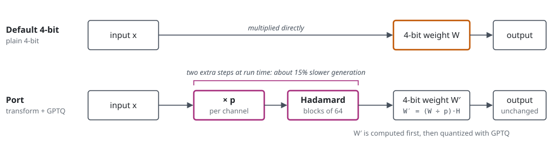
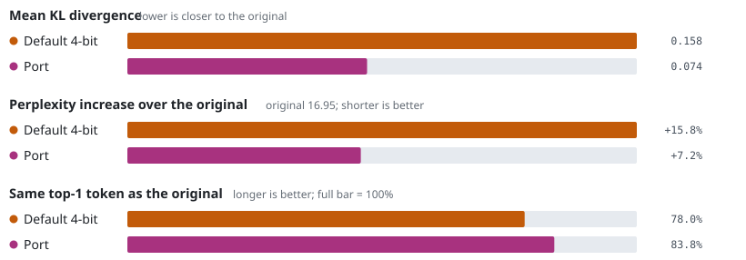
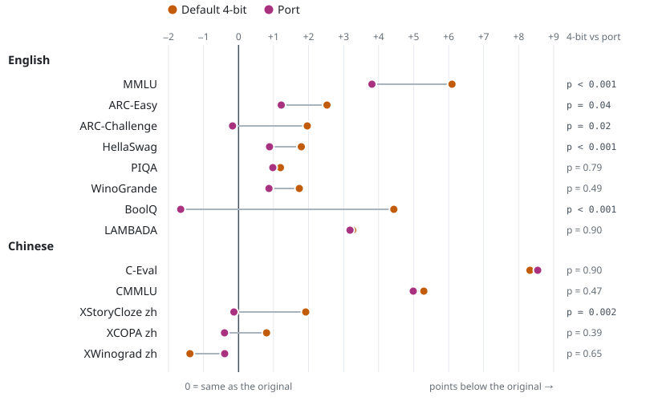
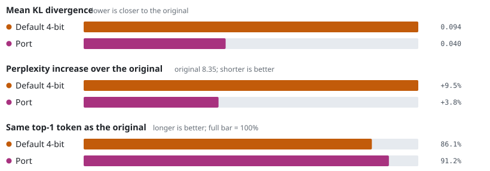
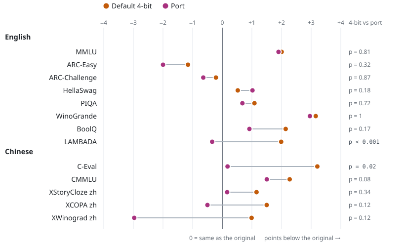

<!-- Generated by docs/build_report.py from docs/report_template.md and results/. Edit those, not report.md. -->

# MACaQ ported to MLX

*Technical report · macaq-mlx 0.1.0 · measurements 2026-11-12 to 11-14*

MACaQ is a 4-bit weight quantization method that runs in its authors' llama.cpp fork. This report describes a port
of its first step, the weight transform, to MLX, with GPTQ in place of its second step. The port was applied to
Qwen3.5-0.8B-Base and Qwen3.5-9B and compared with the bf16 originals and with MLX's default 4-bit quantization of
the same size.

| | |
|---|---|
| Models | Qwen3.5-0.8B-Base; Qwen3.5-9B ([section 6](#6-qwen35-9b)) |
| Variants compared | Original (bf16) · Default 4-bit · Port (4-bit) |
| Machines | Mac mini M2 (16 GB); Mac Studio M3 Ultra (256 GB) |
| Data | Public only: Wikipedia text and standard benchmarks |
| Code | This repository. Every number on this page comes from [`results/`](../results/). |

**Contents:** [0 Summary](#0-summary) · [1 Variants and terms](#1-variants-and-terms) ·
[2 How the port works](#2-how-the-port-works) · [3 Fidelity](#3-fidelity-to-the-original-08b) ·
[4 Public benchmarks](#4-public-benchmarks-08b) · [5 Cost](#5-cost-08b) · [6 Qwen3.5-9B](#6-qwen35-9b) ·
[7 Limitations](#7-limitations) · [8 Appendix](#8-appendix)

## 0. Summary

| | Default 4-bit | Port |
|---|---:|---:|
| 0.8B: mean KL to the original (lower is closer) | 0.158 | **0.074** |
| 0.8B: perplexity above the original | +15.8% | **+7.2%** |
| 9B: mean KL to the original | 0.094 | **0.040** |
| 9B: perplexity above the original | +9.5% | **+3.8%** |
| 0.8B: generation speed on the M2, tokens/s | 146.7 | 124.6 (−15%); 131.3 with the bf16 transform (−10.5%) |

1. **The port works.** MACaQ's first step (the transform) is reproduced exactly in MLX; its second step is replaced
   by GPTQ. The result is a standard MLX 4-bit model of the same size as default 4-bit (425 MB against 424 MB for
   the 0.8B), loaded through one extra model file.
2. **Fidelity, 0.8B.** The port is much closer to the original. Mean KL drops from 0.158 to 0.074; the
   perplexity increase from 15.8% to 7.2%; the share of tokens with the same top-1 prediction as the
   original rises from 78.0% to 83.8%.
3. **Public benchmarks, 0.8B.** 13 tasks, 54,603 questions. The port is significantly better than default 4-bit on
   6 tasks (MMLU, ARC-Easy, ARC-Challenge, HellaSwag, BoolQ, XStoryCloze-zh; the BoolQ gain has another cause, see
   section 4) and significantly worse on none. On the English tasks, default 4-bit loses 2.9 points against
   the original on average and the port 1.1. On the Chinese knowledge tasks (C-Eval, CMMLU) both 4-bit
   variants lose 5 to 8.5 points, and the port does not recover them.
4. **Cost.** Every transformed layer does two extra steps at run time. Generation is about 15% slower
   (10.5% with the transform computed in bf16, section 5).
5. **Qwen3.5-9B.** The same method and code work. Mean KL drops from 0.094 to 0.040, the perplexity increase
   from 9.5% to 3.8%. On the public benchmarks (first 40% of each task, 21,912 questions) the port is
   significantly better on LAMBADA and C-Eval and worse on none; over all questions it is right on 865 that
   default 4-bit gets wrong, against 730 the other way. The ~2-point MMLU loss is not recovered. With the bf16
   transform, generation is 9.5% slower.
6. Both ports were also run through internal, application-specific evaluations on private test sets. Their data and
   results are not part of this report.

## 1. Variants and terms

| Name | Meaning |
|---|---|
| Original | The unquantized model in bf16 (1.6 GB for the 0.8B): `Qwen/Qwen3.5-0.8B-Base` on Hugging Face. Reference only. |
| Default 4-bit | What `mlx_lm.convert -q` produces: MLX affine 4-bit, group 64, round to nearest. 424 MB. |
| Port | This work, 425 MB: MACaQ's transform, then GPTQ to MLX affine 4-bit, group 64. |
| Quantization | Storing each weight in fewer bits. Fewer bits give a smaller file and a larger deviation from the original. |
| KL | Kullback–Leibler divergence between the original's and the quantized model's next-token distributions, averaged over tokens. 0 means identical. Lower is better. |
| Perplexity | How hard the next token is to predict. Lower is better; a quantized model is usually higher than the original, and the smaller the increase the better. |
| Transform | MACaQ's first step: each input channel is multiplied by a scale, then each block of 64 channels by a Hadamard matrix. It does not change the layer's output; it makes the weights easier to quantize. |
| GPTQ | A quantization method that reads calibration text and quantizes a weight matrix column by column, pushing each column's rounding error onto the columns not yet quantized. |
| Discordant questions | Questions that exactly one of two variants answers correctly. Which variant is better is decided on these. |
| p | Two-sided exact McNemar test on the discordant questions. A difference is called significant when p < 0.05. |

## 2. How the port works

### 2.1 What MACaQ does

MACaQ ([`huawei-csl/MACaQ`](https://github.com/huawei-csl/MACaQ), Apache-2.0; this port follows commit `e9d4f89`;
paper [arXiv:2611.10649](https://arxiv.org/abs/2611.10649)) quantizes weights to 4 bits in two steps:

1. **Transform.** For each linear layer, compute one scale per input channel,
   p = clamp(std(W)0.75 / rms(x)0.25, 10−4, 104), rounded to bf16.
   Divide the weight by p and multiply each block of 64 channels by a normalized Hadamard matrix. At run time the
   input is multiplied by p and transformed the same way, so the two cancel and the output is unchanged. After the
   transform, the few very large weights are spread over their block, and the 4-bit grid is no longer spent on them.
2. **Codebook quantization.** Quantize the transformed weights to llama.cpp's IQ4_XS codebook using calibration
   text, followed by a vector-codebook refinement.

### 2.2 What was ported

<picture>
  <source media="(prefers-color-scheme: dark)" srcset="figures/port-diagram-dark.svg">
  
</picture>

**Figure 1. One linear layer, before and after the port.** The scale p and the Hadamard matrix H cancel between
input and weight, so the output is unchanged (measured relative error about 2×10⁻⁶). The 0.8B model has 186 such
layers in 24 decoder layers.

| MACaQ step | In this port | Why |
|---|---|---|
| 1. Transform | **Ported as is.** Formula, exponent 0.75, block width 64 and Hadamard ordering are the same as in MACaQ's source. | MLX has `mx.hadamard_transform`, whose ordering matches MACaQ's Sylvester matrix (the scripts check this on every run). |
| 2. Codebook | **Replaced by GPTQ** on the transformed weights, quantizing to standard MLX 4-bit (group 64). | MLX has no IQ4_XS codebook format; porting it would need a new weight format and Metal kernels. GPTQ also uses calibration text to reduce the error. |

### 2.3 Steps

**A. Teach mlx-lm the transformed model** — [`macaq_mlx/qwen3_5_macaq.py`](../macaq_mlx/qwen3_5_macaq.py)

1. Add a linear layer to mlx-lm's Qwen3.5 model that multiplies its input by p, applies the 64-wide Hadamard
   transform, then does the usual 4-bit matrix multiply. The model type is `qwen3_5_macaq`. `import macaq_mlx`
   registers it; alternatively, copy this one file into mlx-lm's `models` directory.

**B. Transform** — [`macaq_mlx/port_convert.py`](../macaq_mlx/port_convert.py)

2. Run the original on 128 chunks of calibration text (512 tokens each, public Wikipedia, Chinese and English) and
   record the RMS of every input channel of every linear layer.
3. Compute p with MACaQ's formula, rounded to bf16, and transform the weights of the 186 linear layers with p and H.
4. Test the transformed model before quantizing: largest relative error against the original about 2×10⁻⁶; mean KL
   0.001; the homophone task picks the same word as the original on all items. The transform itself adds no
   error.

**C. Quantize** — [`macaq_mlx/port_gptq.py`](../macaq_mlx/port_gptq.py)

5. Run the transformed model on all 261 chunks of calibration text and accumulate, for each linear layer, the
   Hessian of its transformed input (float32). mlx-lm's own GPTQ handles only plain linear layers and sees the input
   before the transform, so this step is written separately.
6. Quantize the 186 linear layers to 4 bits with GPTQ, group 64, damping 0.01; otherwise as in mlx-lm 0.32.2's GPTQ.
7. Quantize the embedding with plain 4-bit. Save standard MLX files; each transformed layer stores one extra vector
   p (about 1 MB in total).

**B + C in one process** — [`macaq_mlx/port_layerwise.py`](../macaq_mlx/port_layerwise.py)

8. Does steps 2 to 7 in one run, collecting Hessians for a group of decoder layers at a time with a checkpoint after
   each group. Used for the 9B (section 6.2). On the 0.8B its output is bit-identical to steps B and C run
   separately (all 880 tensors).

## 3. Fidelity to the original (0.8B)

### 3.1 Method

- Evaluation text: 100 chunks of 512 tokens from public Wikipedia articles (Chinese and English) not used for
  calibration. Only the second half of each chunk is scored, 25,600 tokens in all, as llama.cpp's perplexity tool
  does.
- On every scored token, the original's and the quantized model's predictions give the KL, the perplexity, and
  whether the top-1 token is the same.
- A homophone task of 233 items: one sentence, several candidate words with the same toneless pinyin; the model is
  right if it scores the correct word highest. This is how a small model is used to rank input-method candidates.
- Script: [`scripts/eval_quality.py`](../scripts/eval_quality.py), on the Mac Studio. The same runs on the Mac mini
  agree to three decimals (KL 0.158 and 0.074).

### 3.2 Results

<picture>
  <source media="(prefers-color-scheme: dark)" srcset="figures/fidelity-0.8b-dark.svg">
  
</picture>

**Figure 2. How far each 4-bit variant is from the original.** In the first two metrics the bar length is relative
to default 4-bit = 100%. Data: [`results/qwen3.5-0.8b/quality.json`](../results/qwen3.5-0.8b/quality.json).

| Variant | Mean KL | Perplexity | Same top-1 as original | Homophone accuracy | Homophone, same pick as original |
|---|---:|---:|---:|---:|---:|
| Original | 0 | 16.95 | — | 87.1% | — |
| Default 4-bit | 0.158 | 19.63 (+15.8%) | 78.0% | 87.6% | 96.1% |
| Port | **0.074** | **18.18 (+7.2%)** | **83.8%** | 88.8% | 95.3% |

> [!NOTE]
> The homophone task has only 233 items, and the three variants differ by 1 to 4 of them; it does not separate
> them. KL and perplexity use 25,600 tokens, and their differences are stable.

### 3.3 Other options at similar size

Same evaluation, all on the Mac mini M2. The upstream row is MACaQ's own pipeline in its llama.cpp fork, measured
against an f16 GGUF instead of MLX bf16, so it is comparable only roughly. Data:
[`results/qwen3.5-0.8b/quality-variants-m2.json`](../results/qwen3.5-0.8b/quality-variants-m2.json).

| Variant | Size | Mean KL | Perplexity increase |
|---|---:|---:|---:|
| MLX default 4-bit (group 64) | 424 MB | 0.158 | +15.8% |
| MLX 4-bit, group 32 | 471 MB | 0.118 | +12.1% |
| MLX 4-bit, embedding 6-bit | 488 MB | 0.132 | +12.9% |
| mlx-lm GPTQ 4-bit, embedding 6-bit | 488 MB | 0.060 | +5.6% |
| MLX 5-bit (group 64) | 518 MB | 0.036 | +3.4% |
| Port: transform + round-to-nearest 4-bit | 425 MB | 0.108 | +11.1% |
| **Port: transform + GPTQ 4-bit** | **425 MB** | **0.074** | **+7.2%** |
| Port: transform + GPTQ, embedding 6-bit | 489 MB | 0.047 | +4.3% |
| Upstream MACaQ, IQ4_XS (llama.cpp fork) | 498 MB | 0.034 | +3.5% |

If file size is not the constraint, plain MLX 5-bit is closer to the original and needs no extra code. At the size
of default 4-bit, the port is the closest option found.

## 4. Public benchmarks (0.8B)

### 4.1 Method

- lm-evaluation-harness 0.4.13, with the three variants loaded through mlx-lm's `MLXLM` wrapper. Zero-shot, no chat
  template (this is a base model).
- Each question is scored by appending every answer option to the prompt and taking the option with the highest
  log-likelihood; the model does not generate freely.
- Tasks: the English tasks most often reported for small models (MMLU, ARC, HellaSwag, PIQA, WinoGrande, BoolQ,
  LAMBADA, WikiText), plus Chinese ones (C-Eval, CMMLU, and the Chinese parts of XStoryCloze, XCOPA and XWinograd).
  13 scored tasks, 54,603 questions, plus WikiText perplexity.
- Qwen does not publish scores for the 0.8B base model on these tasks, so the original's column was measured here,
  as a reference only.
- CMMLU's Hugging Face dataset needs a loading script that recent `datasets` versions no longer run. Its official
  CSV release is used instead, with the same prompts as lm-eval's built-in `cmmlu` task
  ([`bench/lmeval/make_cmmlu_tasks.py`](../bench/lmeval/make_cmmlu_tasks.py)).
- Every question's result is kept ([`results/lmeval-0.8b/`](../results/lmeval-0.8b/)), so the variants are compared
  on discordant questions.

### 4.2 Results

<picture>
  <source media="(prefers-color-scheme: dark)" srcset="figures/benchmarks-0.8b-dark.svg">
  
</picture>

**Figure 3. Points lost against the original on each task.** Further left is closer to the original; left of 0 is
above the original. p compares the two 4-bit variants question by question; significant ones are darker. English
average: default 4-bit −2.9, port −1.1. Chinese average: default 4-bit −3.0, port −2.5.
Data: [`results/lmeval-0.8b/summary.json`](../results/lmeval-0.8b/summary.json).

| Task | Questions | Original | Default 4-bit | Port | Only 4-bit right / only port right | p |
|---|---:|---:|---:|---:|---:|---:|
| **English** | | | | | | |
| MMLU, 57 subjects | 14,042 | 52.8 | 46.7 (−6.1) | **49.0 (−3.8)** | 1379 / 1700 | < 0.001 |
| ARC-Easy, grade-school science | 2,376 | 70.4 | 67.8 (−2.5) | **69.1 (−1.2)** | 93 / 124 | 0.04 |
| ARC-Challenge | 1,172 | 40.6 | 38.7 (−2.0) | **40.8 (+0.2)** | 42 / 67 | 0.02 |
| HellaSwag, commonsense continuation | 10,042 | 54.8 | 53.0 (−1.8) | **53.9 (−0.9)** | 278 / 369 | < 0.001 |
| PIQA, physical commonsense | 1,838 | 71.7 | 70.5 (−1.2) | 70.7 (−1.0) | 61 / 65 | 0.79 |
| WinoGrande, coreference | 1,267 | 60.6 | 58.9 (−1.7) | 59.7 (−0.9) | 99 / 110 | 0.49 |
| BoolQ, yes/no reading | 3,270 | 74.7 | 70.2 (−4.4) | **76.3 (+1.7)** | 271 / 470 | < 0.001 |
| LAMBADA, last word | 5,153 | 50.7 | 47.5 (−3.3) | 47.5 (−3.2) | 291 / 295 | 0.90 |
| **Chinese** | | | | | | |
| C-Eval, 52 exam subjects | 1,346 | 54.2 | 45.8 (−8.3) | 45.6 (−8.5) | 121 / 118 | 0.90 |
| CMMLU, 67 subjects | 11,582 | 53.1 | 47.8 (−5.3) | 48.1 (−5.0) | 1076 / 1111 | 0.47 |
| XStoryCloze zh, story ending | 1,511 | 58.0 | 56.1 (−1.9) | **58.1 (+0.1)** | 33 / 64 | 0.002 |
| XCOPA zh, cause and effect | 500 | 63.2 | 62.4 (−0.8) | 63.6 (+0.4) | 14 / 20 | 0.39 |
| XWinograd zh, coreference | 504 | 68.8 | 70.2 (+1.4) | 69.2 (+0.4) | 41 / 36 | 0.65 |
| **Perplexity (lower is better)** | | | | | | |
| WikiText, word perplexity | 62 docs | 16.64 | 19.33 | 17.85 | — | — |
| LAMBADA, last word | 5,153 | 11.67 | 13.56 | 13.45 | — | — |

Scores are percent correct; the number in parentheses is the difference from the original. Bold marks the better
4-bit variant where the two differ significantly (p < 0.05). ARC-Challenge, HellaSwag and PIQA use the
length-normalized score, as is customary; the others use plain accuracy.

> [!NOTE]
> On the English tasks, the port recovers part of what default 4-bit loses: about 40% on MMLU, half or more on ARC,
> HellaSwag and WinoGrande. On the Chinese knowledge tasks (C-Eval, CMMLU) and on LAMBADA both 4-bit variants lose
> the same, and the port recovers nothing. The three Chinese commonsense tasks (story ending, cause and effect,
> coreference) lose little to begin with.

> [!WARNING]
> **BoolQ needs a separate look.** On BoolQ the port scores 1.7 points above the original. This is not better
> understanding. BoolQ is yes/no, and 62% of the correct answers are "yes". The original answers "yes" to 73% of the
> questions, default 4-bit to 68%, the port to 62%. Answering "yes" less often, the port gets more of the "no"
> questions right (69%, original 52%); on the "yes" questions it does the same as default 4-bit (81%, original 88%).

## 5. Cost (0.8B)

| Item | Default 4-bit | Port |
|---|---:|---:|
| File size | 424 MB | 425 MB |
| Peak memory (512-token prompt, 128 generated) | 1.06 GB | 1.08 GB |
| Generation, tokens/s | 146.7 | 124.6 (−15%) |
| Generation with the bf16 transform, tokens/s | — | 131.3 (−10.5%) |
| Needed at run time | — | one model file, `qwen3_5_macaq.py` |

- Speed was measured on the Mac mini M2 (16 GB), median of 5 runs in one sitting
  ([`scripts/bench_speed.py`](../scripts/bench_speed.py),
  [`results/qwen3.5-0.8b/speed-m2.json`](../results/qwen3.5-0.8b/speed-m2.json)).
- The slowdown comes from two small extra GPU operations per linear layer (scale and transform). Over 186 layers
  they add about 1.2 ms per generated token (6.8 ms → 8.0 ms).
- The bf16 transform (p stored in bf16, scale and transform computed in bf16) leaves the quality practically
  unchanged on the 0.8B (KL 0.0743 against 0.0743, perplexity 18.18 against 18.18). It is selected with
  `macaq.pre_dtype` in the model's config (section 6.2) and is what the conversion scripts now write by default; the
  0.8B measurements above use float32. Removing the overhead entirely would need a fused Metal kernel that does the
  transform and the 4-bit matrix multiply in one step.

## 6. Qwen3.5-9B

The same method and code were applied to Qwen3.5-9B, followed by the same fidelity measurement and public
benchmarks.

### 6.1 Variants

| Name | Meaning |
|---|---|
| Original | The unquantized model in bf16 (19.3 GB): `Qwen/Qwen3.5-9B` on Hugging Face, revision `c2022362`. Reference only. |
| Default 4-bit | `mlx-community/Qwen3.5-9B-4bit` (revision `8b2b98c0`), 5.95 GB. Plain 4-bit; includes the vision tower (about 0.9 GB). |
| Port | This work, 5.04 GB, text only. Transform + GPTQ. |

### 6.2 Differences from the 0.8B port

Same two steps, same code, same calibration text: 128 chunks for the statistics, 261 for GPTQ, 512 tokens each.
What differs:

| Item | 0.8B | 9B |
|---|---|---|
| Transformed linear layers | 186 in 24 layers | 248 in 32 layers (24 linear-attention, 8 full-attention) |
| Output layer | Tied to the embedding | Separate. MACaQ transforms only the decoder layers, so it gets plain GPTQ |
| Memory | One pass | Hessians for 8 layers at a time, 4 passes, a checkpoint after each (`macaq-port`). Weights stay unquantized until every pass is done, so each layer's Hessian still comes from the unquantized model, as in one pass |
| Time | — | 32 minutes on the M3 Ultra, 33 GB memory peak |
| File | 425 MB | 5.04 GB, text only |

Three changes were made for serving engines, and apply to both models:

1. **The port's layer no longer subclasses MLX's quantized linear layer.** oMLX 0.7.2 replaces every
   `QuantizedLinear` with its own matrix multiply for prompts over 2048 tokens, which skipped the input transform and
   produced garbage on a 4,080-token prompt. With the change, oMLX and mlx-lm give token-identical output on short
   prompts and on the 4,080-token prompt. Parameter names are unchanged, so existing files still load.
2. **Config.** `architectures` is set to `Qwen3_5MacaqForCausalLM`; otherwise oMLX loads the model as a
   vision-language model.
3. **Input transform in bf16.** Casting the input to float32 for the transform makes long prompts need more
   transient memory (section 6.5), which made oMLX's memory guard pause requests. The loader reads
   `macaq.pre_dtype` from the config (float32, bfloat16 or float16; float32 when absent). Against float32, the bf16
   transform on the 9B port gives KL 0.0008, perplexity 8.6683 → 8.6682, and the same pick on every homophone
   item.

### 6.3 Fidelity

Method as in 3.1: the same 100 chunks (25,600 scored tokens) and the same 233 homophone items.

<picture>
  <source media="(prefers-color-scheme: dark)" srcset="figures/fidelity-9b-dark.svg">
  
</picture>

**Figure 4. How far each 9B 4-bit variant is from the original.** In the first two metrics the bar length is
relative to default 4-bit = 100%. As on the 0.8B, the port more than halves the KL. Data:
[`results/qwen3.5-9b/quality.json`](../results/qwen3.5-9b/quality.json).

| Variant | Mean KL | Perplexity | Same top-1 as original | Homophone accuracy | Homophone, same pick as original |
|---|---:|---:|---:|---:|---:|
| Original | 0 | 8.35 | — | 90.1% | — |
| Default 4-bit | 0.094 | 9.14 (+9.5%) | 86.1% | 90.1% | 98.7% |
| Port | **0.040** | **8.67 (+3.8%)** | **91.2%** | 90.1% | 99.1% |

The port's row was measured with the float32 transform. The bf16 transform differs from it by KL 0.0008, far
less than the 0.054 between the two 4-bit variants.

### 6.4 Public benchmarks

- Same setup as section 4: lm-evaluation-harness 0.4.13, the same 13 tasks, zero-shot, scored by option
  log-likelihood.
- To finish in a day, only the first 40% of each task was used (for MMLU, C-Eval and CMMLU, the first 40% of each
  subject): 21,912 questions, the same for all three variants. The fraction was set from the timing of a 2% trial
  run.
- The 9B is a chat model; as for the 0.8B, no chat template is applied. The scores compare the three variants with
  each other, not with Qwen's published numbers.
- The port ran with the bf16 transform.

<picture>
  <source media="(prefers-color-scheme: dark)" srcset="figures/benchmarks-9b-dark.svg">
  
</picture>

**Figure 5. 9B: points lost against the original on each task.** Read as figure 3, on a narrower axis: every 9B
difference is within 3.5 points. English average: default 4-bit −1.2, port −0.6. Chinese average: default
4-bit −1.8, port +0.3 (mostly from the small XWinograd set, see below). Data:
[`results/lmeval-9b/summary.json`](../results/lmeval-9b/summary.json).

| Task | Questions | Original | Default 4-bit | Port | Only 4-bit right / only port right | p |
|---|---:|---:|---:|---:|---:|---:|
| **English** | | | | | | |
| MMLU, 57 subjects | 5,636 | 78.8 | 76.8 (−2.0) | 76.9 (−1.9) | 207 / 213 | 0.81 |
| ARC-Easy, grade-school science | 951 | 80.5 | 81.7 (+1.2) | 82.5 (+2.0) | 21 / 29 | 0.32 |
| ARC-Challenge | 469 | 53.3 | 53.5 (+0.2) | 53.9 (+0.6) | 19 / 21 | 0.87 |
| HellaSwag, commonsense continuation | 4,017 | 72.2 | 71.7 (−0.5) | 71.2 (−1.0) | 110 / 90 | 0.18 |
| PIQA, physical commonsense | 736 | 81.8 | 80.7 (−1.1) | 81.1 (−0.7) | 14 / 17 | 0.72 |
| WinoGrande, coreference | 507 | 74.2 | 71.0 (−3.2) | 71.2 (−3.0) | 28 / 29 | 1 |
| BoolQ, yes/no reading | 1,308 | 90.2 | 88.1 (−2.1) | 89.3 (−0.9) | 51 / 67 | 0.17 |
| LAMBADA, last word | 2,062 | 70.3 | 68.3 (−2.0) | **70.7 (+0.3)** | 65 / 113 | < 0.001 |
| **Chinese** | | | | | | |
| C-Eval, 52 exam subjects | 561 | 76.3 | 73.1 (−3.2) | **76.1 (−0.2)** | 15 / 32 | 0.02 |
| CMMLU, 67 subjects | 4,658 | 80.7 | 78.4 (−2.3) | 79.2 (−1.5) | 183 / 219 | 0.08 |
| XStoryCloze zh, story ending | 605 | 66.1 | 65.0 (−1.2) | 66.0 (−0.2) | 11 / 17 | 0.34 |
| XCOPA zh, cause and effect | 200 | 74.5 | 73.0 (−1.5) | 75.0 (+0.5) | 0 / 4 | 0.12 |
| XWinograd zh, coreference | 202 | 77.7 | 76.7 (−1.0) | 80.7 (+3.0) | 6 / 14 | 0.12 |
| **Perplexity (lower is better)** | | | | | | |
| WikiText, word perplexity | 25 docs | 8.98 | 9.55 | 9.17 | — | — |
| LAMBADA, last word | 2,062 | 3.79 | 4.31 | 3.88 | — | — |

As in section 4: the number in parentheses is the difference from the original, and bold marks the significantly
better 4-bit variant. Question counts are after taking the first 40%.

> [!NOTE]
> The port is significantly better on 2 tasks, LAMBADA (discordant 65 vs 113) and C-Eval (15 vs 32), and
> significantly worse on none. Over all questions it is right more often (730 against 865,
> p < 0.001). The perplexities agree with section 6.3: on WikiText default 4-bit is 6.4% above the original and the
> port 2.1%; on LAMBADA 13.6% against 2.4%. On the Chinese knowledge tasks, default 4-bit loses 3.2 points on C-Eval
> and the port 0.2; on CMMLU 2.3 against 1.5. On the English knowledge task MMLU, however, both lose about 2 points,
> and the port does not recover them. The 0.8B shows the opposite: MMLU partly recovered, C-Eval and CMMLU not.

> [!WARNING]
> With 13 separate comparisons, one p below 0.05 by chance would not be unusual. LAMBADA (p < 0.001) is backed by
> both perplexities and is the more reliable result; C-Eval rests on 47 discordant questions (p = 0.02) and should
> be read with care. XCOPA and XWinograd have about 200 questions each, so one question is 0.5 points; the port being
> 3.0 points above the original on XWinograd means nothing. On BoolQ the port again answers "yes" less often (58%,
> original 64%, default 4-bit 66%; 63% of the correct answers are "yes"), the same direction as on the 0.8B, but here
> the two 4-bit variants do not differ significantly.

### 6.5 Speed and memory

| Item | Default 4-bit | Port, float32 transform | Port, bf16 transform |
|---|---:|---:|---:|
| Generation, tokens/s | 114.9 | 96.7 (−15.8%) | 104.0 (−9.5%) |
| Prompt processing (512 tokens), tokens/s | 1148 | 1065 | 1095 |
| Peak memory (512-token prompt, 128 generated) | 5.93 GB | 6.32 GB | 6.01 GB |
| Transient memory of one 4,096-token prefill | 2.76 GB | 3.11 GB | 2.80 GB |

- mlx-lm on the Mac Studio M3 Ultra, one sitting, median of 5 runs
  ([`scripts/bench_speed.py`](../scripts/bench_speed.py), [`scripts/prefill_peak.py`](../scripts/prefill_peak.py);
  [`results/qwen3.5-9b/speed-m3ultra.json`](../results/qwen3.5-9b/speed-m3ultra.json)). The Mac Studio is a shared
  machine.
- oMLX estimates the transient memory of a prefill before running it and pauses the request if the estimate exceeds
  its memory limit. With the float32 transform this happened regularly in our serving test; with the bf16 transform,
  whose transient memory is close to default 4-bit's, it almost never did.
- The extra ~0.9 GB in default 4-bit's file is the vision tower; counting the text model only, the two 4-bit
  variants are the same size.

## 7. Limitations

- Every evaluation was run once. The benchmark comparisons are question by question; differences of a few questions
  need the p value, not just the percentages.
- The public benchmarks measure general ability with zero-shot, multiple-choice scoring and no chat template. The 9B
  results use the first 40% of each task, so single-task scores vary more than on full tasks. Neither model's scores
  should be compared with Qwen's published numbers.
- MACaQ's second step (codebook refinement) is not ported. Its full pipeline in llama.cpp reaches KL about 0.034 on
  the 0.8B, half the port's 0.074, but at 498 MB (73 MB larger), and it runs only in MACaQ's llama.cpp fork.
- There is no fused Metal kernel, so the port remains 10–15% slower in generation.
- The 9B port is text only: the vision tower is dropped.
- 9B speed was measured only on the M3 Ultra, not on a 16 GB machine.
- The Mac Studio was shared with other jobs during the benchmarks, so their run times are not used as speed
  measurements.
- Only two Qwen3.5 models were tested, with one version of MLX (0.32.4) and mlx-lm (0.32.2). Other architectures
  need their list of linear layers adapted.
- The internal evaluations mentioned in section 0 used private data and are not reported.

## 8. Appendix

**Software**

- Python 3.12, mlx 0.32.4, mlx-lm 0.32.2 (exact versions in [`requirements.txt`](../requirements.txt))
- Public benchmarks: lm-evaluation-harness 0.4.13, datasets 5.2.0, mlx-lm's `MLXLM` wrapper, batch size 16
- Serving checks: oMLX 0.7.2
- Loader `qwen3_5_macaq.py`: `macaq.pre_dtype` in the config sets the transform's precision (float32, bfloat16 or
  float16; float32 when absent)
- MACaQ commit `e9d4f89c2110f5c2b1ea1df10c2a8656aed19ff4`

**Machines**

- Mac mini M2, 16 GB, macOS 26.4.1: 0.8B conversion and speed; the variants in 3.3.
- Mac Studio M3 Ultra, 256 GB, macOS 26.4.1, shared, jobs run at low priority: 0.8B fidelity and benchmarks; 9B
  conversion and every 9B measurement.
- The model files on the two machines were checked to have identical sha256.

**Model files measured**

| File | Bytes | sha256 |
|---|---:|---|
| 0.8B original `model.safetensors-00001-of-00001.safetensors` (HF revision dc7cdfe2) | — | `c2b1e5a17d9c1e27685d92ed9b382911ebb99955ecd89052d1721241adfbab6c` |
| 0.8B default 4-bit `model.safetensors` (output of `mlx_lm.convert -q`) | 424,026,782 | `8d7883bce060432705aa0e48e8743babd47d7c3d6ca89e8d63574549b52ea3ad` |
| 0.8B port `model.safetensors` | 425,156,526 | `b8de17ed78a68017cfb252f14b7cfc616b1f7ba6beec4d9d4284cc53be2a4344` |
| 9B original, 4 files (HF revision c2022362) | 19,306,310,880 | — |
| 9B default 4-bit `model-00001-of-00002.safetensors` (mlx-community, HF revision 8b2b98c0) | 5,349,771,222 | `a68b87558c6ef43f74c2bd63ce7e9092ceddc3101f3def0030774bae5f42aadd` |
| 9B default 4-bit `model-00002-of-00002.safetensors` | 600,449,850 | `b0a770bf8469c7f3f18756a0e0283f1c1174344a83e059a4e483f6af4907352d` |
| 9B port `model.safetensors` | 5,043,306,597 | `195fa579e1212444d3ab01208e2b7907d1f271996abfef800f1e90b930f96b95` |

A conversion on other hardware or software versions may not reproduce the port's hashes bit for bit.

**Data**

- Calibration and evaluation text: public Wikipedia (`wikimedia/wikipedia` 20231101.zh and .en, CC BY-SA 4.0),
  disjoint articles, made by [`scripts/make_data.py`](../scripts/make_data.py); sha256 in
  [`data/SHA256SUMS`](../data/SHA256SUMS).
- Homophone items: built from the Chinese evaluation articles
  ([`data/homophone-clean.jsonl`](../data/homophone-clean.jsonl), CC BY-SA 4.0).
- Public benchmarks: each task's public dataset, downloaded from Hugging Face by lm-eval's task definitions; CMMLU
  from its official CSV release (`cmmlu_v1_0_1.zip`), which is not redistributed here.
- No private data was used for anything reported on this page.
